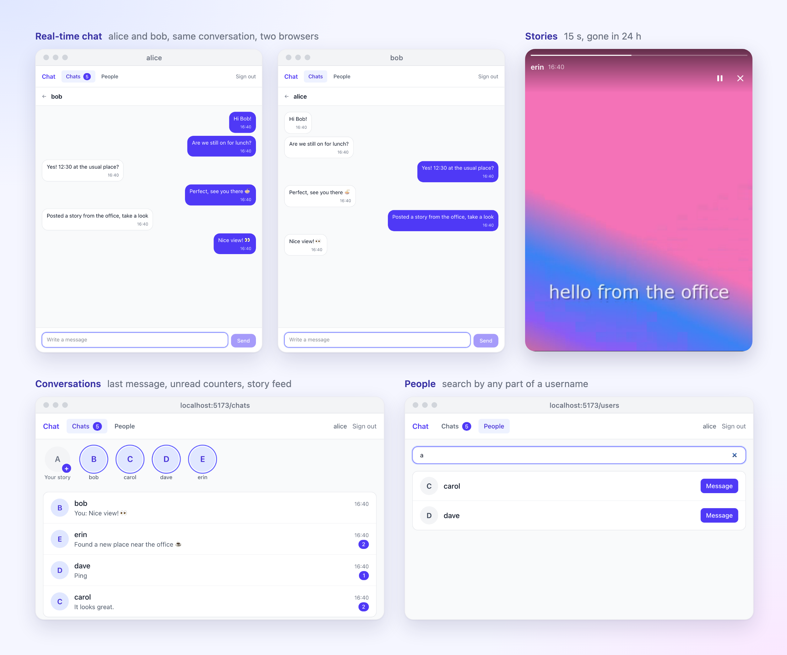
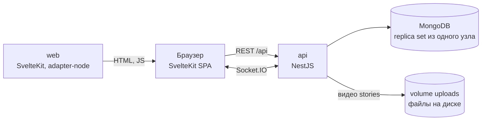

# Wise Chat

Веб-чат один на один: регистрация, поиск пользователей, диалоги и сообщения в реальном времени по
WebSocket, видео-истории на 24 часа. NestJS и MongoDB на бэкенде, SvelteKit на фронтенде,
Socket.IO между ними.



Задание — в [docs/TASK.md](docs/TASK.md), границы и приоритеты — в [docs/VISION.md](docs/VISION.md),
устройство и решения подробно — в [docs/ARCHITECTURE.md](docs/ARCHITECTURE.md).

## Быстрый старт

Нужен Docker с Compose v2.

```bash
docker compose up --build
```

Когда все три сервиса станут `healthy`, откройте <http://localhost:5173>. API отвечает на
<http://localhost:3000/api>, MongoDB наружу не публикуется.

Демо-данные (необязательно): пять пользователей `alice`, `bob`, `carol`, `dave`, `erin`
(`<имя>@example.com`, пароль у всех `demo-password-1`) и три диалога с непрочитанными сообщениями:

```bash
docker compose exec api node dist/seed/seed.js
```

Скрипт можно запускать повторно: существующее он не трогает.

Остановить: `docker compose down`; удалить и данные: `docker compose down -v`.

> `JWT_SECRET` в `docker-compose.yml` — демо-значение, чтобы проект запускался без настройки.
> Для любого окружения, кроме локального, задайте свой в `.env` рядом с `docker-compose.yml`:
> `JWT_SECRET=$(openssl rand -base64 48)`.

Если порты 3000 или 5173 заняты, их можно сменить в `.env`: `API_PORT=3100`, `WEB_PORT=5273`.

Запись stories требует камеру, а браузер даёт её только на `localhost` или по HTTPS.

## Что сделано

Из задания:

- регистрация и вход; сессия из access-JWT на 15 минут (в памяти браузера) и refresh-токена
  в HttpOnly-cookie, который ротируется при каждом использовании, повтор старого токена
  завершает сессию; выход сразу отключает и REST, и сокеты этой сессии; защищённые маршруты на бэкенде и фронтенде;
- список всех пользователей с пагинацией и поиск по username (по подстроке, без учёта регистра);
- диалоги один на один: создание, список с последним сообщением, отправка и получение по
  WebSocket;
- валидация входящих данных, единый формат ошибок, состояния loading и error в интерфейсе;
- stories: запись с веб-камеры до 15 секунд, лента авторов с активными историями, просмотр,
  автоудаление через 24 часа;
- Docker Compose и тесты.

Сверх задания, потому что без этого чат работает ненадёжно:

- отправка в одной транзакции: номер сообщения в диалоге (`seq`) без пропусков, превью диалога и
  счётчики непрочитанных всегда согласованы;
- повтор отправки не создаёт дубль (`clientMessageId`), сообщение видно сразу со статусом
  `sending` / `sent` / `failed`;
- клиент замечает пропуск в номерах и догружает недостающее, после переподключения догружает всё
  пропущенное;
- счётчик непрочитанных, сброс при прочтении во всех вкладках.


## Архитектура



- **api** (`apps/api`) — один процесс NestJS: REST, Socket.IO gateway, cron очистки stories.
  Видео stories лежат на диске (volume `uploads` в Docker).
- **web** (`apps/web`) — SvelteKit 3, приложение целиком работает в браузере, состояние в Svelte
  stores.
- **MongoDB 8.0** — replica set из одного узла: он нужен для транзакций.

Путь одного сообщения: клиент показывает его сразу → `message:send` по сокету → проверка доступа
→ транзакция (номер, сообщение, превью, счётчики) → после коммита `message:new` во все вкладки
обоих участников → ack отправителю.

## Решения и почему

| Решение | Почему |
|---|---|
| Отправка и доставка по сокету, REST — для истории | Так требует ТЗ; REST-отправка оставлена запасным путём через тот же сервис |
| Транзакции и replica set из одного узла | Сообщение, номер, превью и счётчики меняются вместе; без транзакции счётчик при сбое разъехался бы навсегда |
| Номер `seq` в диалоге | Порядок, курсор истории и обнаружение пропусков не зависят от времени и `_id` |
| Без transactional outbox | При одном процессе бэкенда его падение рвёт все сокеты, и клиенты сами догружают пропущенное. Outbox понадобится с несколькими репликами |
| scrypt из `node:crypto` | Вариант OWASP, без нативных зависимостей в Docker |
| Access JWT 15 минут в памяти + refresh-токен в HttpOnly-cookie с ротацией | В `localStorage` токен прочитает любой скрипт страницы, и украденный будет работать до истечения срока. Поэтому долгоживущий refresh-токен лежит в HttpOnly-cookie, недоступной скрипту, а access-токен — только в памяти вкладки: не переживает её закрытие и живёт 15 минут. XSS может действовать лишь от имени открытой страницы и недолго. Guard на каждом запросе проверяет, что сессия токена жива, поэтому выход отзывает access-токен сразу, не дожидаясь 15 минут. Access-токен не в cookie, чтобы API не зависел от cookie и CSRF: refresh-cookie уходит только на `/api/auth` с `SameSite=Strict`. Ротация обнаруживает украденный refresh-токен при повторном использовании. Подробности в [docs/ARCHITECTURE.md](docs/ARCHITECTURE.md) |
| Поиск по подстроке | «ob» находит «bob»; цена — просмотр всех username, для тестового объёма это миллисекунды |
| Порядок отправок одного автора через `maxConcurrentMessages: 1` | Встроенная опция `IoAdapter` в Nest 12 вместо своей очереди |
| Видео stories по подписанной ссылке с поддержкой Range | `<video src>` не умеет отправлять `Authorization`, поэтому клиент получает короткоживущую ссылку (`/playback`); сервер отвечает `206`, `ETag` и `304`, видео стартует без полной загрузки, Safari требует Range |
| Видео stories на локальном диске (volume `uploads`) | Один процесс API, отдельный сервис хранения был бы лишним. Доступ к файлам идёт через абстракцию `StoryStorage`, так что S3 — вторая реализация, а не переписывание. При нескольких репликах диск не подходит, см. «Ограничения» |
| Загрузка видео потоком на диск, а не в память | Multer пишет файл в `UPLOADS_DIR/.incoming`, сервис читает первые 64 байта и переименовывает файл; вес запроса не влияет на память API |
| Автоудаление: фильтр `expiresAt` + cron + TTL-индекс | История исчезает из выдачи ровно через 24 часа; cron удаляет файл и документ, TTL-индекс — подстраховка, сам он файл не удалил бы |
| Тип видео по первым байтам | Имени и `Content-Type` от клиента верить нельзя; нужны два формата: MP4 (Chrome, Safari) и WebM (Firefox) |

## API

REST с префиксом `/api`. Открыты только `POST /auth/register`, `/auth/login`, `/auth/refresh`,
`/auth/logout`, `GET /health` и `GET /stories/:id/video` (по подписанному токену из ссылки),
остальное требует `Authorization: Bearer <token>`. Ошибки всегда имеют вид
`{ statusCode, error, message, details? }`.

| Метод | Путь | Что делает |
|---|---|---|
| POST | `/auth/register` | `{ email, username, password }` → `{ accessToken, user }` |
| POST | `/auth/login` | `{ email, password }` → `{ accessToken, user }` |
| POST | `/auth/refresh` | refresh-cookie → новый `{ accessToken, user }` и новая cookie (ротация) |
| POST | `/auth/logout` | завершить сессию и удалить cookie; `204` |
| GET | `/auth/me` | текущий пользователь |
| GET | `/users?search=&cursor=&limit=` | все пользователи кроме себя, страницами; `search` — подстрока username |
| GET | `/conversations` | мои диалоги, свежие сверху, с `unreadCount` |
| POST | `/conversations` | `{ userId }` → найти или создать диалог |
| GET | `/conversations/:id` | один диалог |
| GET | `/conversations/:id/messages?before=&after=&limit=` | история по `seq` |
| POST | `/conversations/:id/messages` | `{ text, clientMessageId }` — запасной путь отправки |
| POST | `/conversations/:id/read` | `{ seq }` → отметить прочитанным |
| POST | `/stories` | multipart: `video` (MP4 или WebM, до 20 МБ), `durationMs` (до 15 с) |
| GET | `/stories/feed` | авторы с активными историями: сначала свои, затем по свежести; не больше 200 свежих историй, у каждой `seen` |
| POST | `/stories/:id/view` | отметить историю просмотренной (идемпотентно) |
| GET | `/stories/:id/playback` | подписанная ссылка на видео (`videoUrl`, `expiresAt`), живёт `MEDIA_TOKEN_TTL_SECONDS` |
| GET | `/stories/:id/video?token=` | видео истории: Range (`206`/`416`), `ETag`, `If-Range`, `304`; доступ по токену из ссылки |
| DELETE | `/stories/:id` | удалить свою историю |
| GET | `/health` | проверка живости |

Socket.IO на том же адресе, токен в `auth: { token }`. Отказ при подключении приходит с
`data.code`: `UNAUTHORIZED` (выйти), `TOKEN_EXPIRED` или `UNAVAILABLE` (сервер не смог проверить
сессию; повторить подключение).

| Направление | Событие | Данные |
|---|---|---|
| клиент → сервер | `message:send` | `{ conversationId, text, clientMessageId }`, ack `{ ok, data \| error }` |
| клиент → сервер | `conversation:read` | `{ conversationId, seq }`, ack `{ ok, data \| error }` |
| сервер → клиент | `message:new` | `{ message, conversation }` — каждому участнику свой вид диалога |
| сервер → клиент | `conversation:read` | `{ conversationId, lastReadSeq, unreadCount }` — во вкладки читающего |
| сервер → клиент | `story:created`, `story:deleted` | `story:created` — `{ story, author }`, `story:deleted` — `{ storyId, authorId }`; всем, лента общая |

## Разработка

Нужны Node.js 24, pnpm 10 и Docker (только для MongoDB).

```bash
pnpm install
cp .env.example .env
pnpm db:up
pnpm dev
```

`pnpm db:up` поднимает MongoDB отдельным Compose-проектом с портом на `127.0.0.1:27017`,
`pnpm db:down` останавливает её. Фронтенд — <http://localhost:5173>, API — <http://localhost:3000>.

| Команда | Что делает |
|---|---|
| `pnpm dev` | API и фронтенд в watch-режиме |
| `pnpm test` | все тесты |
| `pnpm lint` | ESLint и Prettier |
| `pnpm typecheck` | `tsc` и `svelte-check` |
| `pnpm build` | production-сборка |
| `pnpm seed` | демо-пользователи и диалоги в базе из `.env` (пароль `demo-password-1`) |

## Тесты

```bash
pnpm test
```

- **API** (Jest, supertest, socket.io-client) — 155 тестов на настоящем приложении и
  replica set в памяти, так что транзакции настоящие: регистрация и вход, лимит попыток входа,
  поиск и пагинация, 20 одновременных отправок без пропусков в номерах, повторы без дублей,
  инвариант непрочитанных при параллельных чтениях и отправках, доступ к чужим диалогам,
  подключение сокета, ack и ошибки в нём, порядок отправок одной вкладки, лимит событий;
  stories — тип по байтам, лимиты размера и длительности, лента, видео, истёкшие и cron;
  refresh-сессии и request-id.
- **Web** (Vitest) — 97 тестов: HTTP-клиент и stores — отправка до ответа сервера, слияние ack и
  события, повтор, обнаружение пропуска и догрузка; переходы между историями, кэш видео, выбор
  формата записи, починка WebM (длительность, ключевые кадры звука).
- **End-to-end** (Playwright, Chromium) — `apps/e2e` гоняет весь стак в настоящем браузере:
  регистрация и вход, поиск людей, чат двух пользователей в реальном времени, счётчики
  непрочитанных и stories (запись с синтетической камеры).

`pnpm test` запускает API и web; e2e — отдельно, против поднятого Docker Compose:

```bash
AUTH_RATE_LIMIT_PER_MINUTE=1000 docker compose up --build --detach --wait   # тесты регистрируют много пользователей
pnpm --filter e2e install:browsers                                          # один раз
pnpm --filter e2e e2e                                                       # или e2e:ui
```

`E2E_WEB_URL` и `E2E_API_URL` направляют тесты на другой адрес.

CI (`.github/workflows/ci.yml`) на push в `main` и на pull request запускает lint, typecheck и unit-тесты,
затем тот же e2e-набор против `docker compose`.

Первый запуск скачивает `mongod` для тестов (в кэше около 180 МБ) в `~/.cache/mongodb-binaries`, дальше
работает из кэша. Без сети тесты можно направить на MongoDB из Docker:

```bash
pnpm db:up && MONGO_TEST_URI="mongodb://127.0.0.1:27017/?directConnection=true" pnpm test
```

## Нагрузочный тест

Проверяли, держит ли один процесс API заметную нагрузку без потерь. Пользователи разбиты на
пары, у каждой пары свой диалог, каждый пользователь подключён по сокету. В течение 60 секунд
каждый шлёт сообщения собеседнику с заданной частотой и раз в секунду запрашивает по REST список
диалогов и поиск. По каждому сообщению замеряли время до ack у отправителя и до `message:new` у
получателя, а в конце сверяли, что всё отправленное подтверждено и доставлено.

Стенд: `docker compose up` из этого репозитория на MacBook M1 Pro (Docker: 8 CPU, 8 ГБ),
один процесс API, MongoDB replica set из одного узла, нагрузка подавалась с той же машины.
Лимит регистраций был поднят (`AUTH_RATE_LIMIT_PER_MINUTE=100000`).

200 пользователей, 100 диалогов, 200 сокетов:

| Нагрузка | Сообщений | В секунду | ack p50 / p95 / p99 | Доставка p95 | REST p95 (диалоги / поиск) | Потери |
|---|---|---|---|---|---|---|
| 1 сообщение/с на пользователя | 11 988 | 187 | 12 / 47 / 88 мс | 47 мс | 24 / 69 мс | 0 |
| 2 сообщения/с на пользователя | 23 961 | 371 | 50 / 1111 / 1348 мс | 1111 мс | 219 / 276 мс | 0 |

Во всех прогонах ни одной ошибки, ни одного потерянного сообщения (отправлено = подтверждено =
доставлено), ни одного оборванного сокета. Около 190 сообщений в секунду API обрабатывает с
задержкой в десятки миллисекунд. При удвоении нагрузки сервер упирается в свой предел: вместо 400 сообщений в
секунду проходит 371, и хвост задержек растёт до секунды. Узкое место — транзакция на каждое
сообщение (номер `seq`, превью, счётчики) в одном процессе Node.js. Дальше масштабирование —
несколько реплик API с адаптером Socket.IO, см. «Ограничения».

Регистрация медленная намеренно: scrypt занимает CPU, при 20 параллельных регистрациях p50 около
1,6 с. Подключение сокета — p95 до 112 мс.

Как повторить: скрипт [`loadtest/load.mjs`](loadtest/load.mjs) берёт `socket.io-client` из
зависимостей API, поэтому сначала `pnpm install`. Поднимите стек с поднятым лимитом регистраций
и запустите тест:

```bash
AUTH_RATE_LIMIT_PER_MINUTE=100000 docker compose up --build --detach --wait
```

```bash
pnpm loadtest --users 200 --duration 60 --rate 1 --rest 1
```

`--users` — число пользователей (чётное, они разбиваются на пары), `--duration` — секунды
переписки, `--rate` — сообщений в секунду на пользователя (сервер пропускает до 10), `--rest` —
REST-запросов в секунду на пользователя. `API_URL` задаёт адрес API (по умолчанию
`http://localhost:3000`). В конце скрипт печатает задержки p50/p95/p99 по каждой операции и
сверку «отправлено / подтверждено / доставлено». Каждый запуск создаёт новых пользователей в
базе; очистить её — `docker compose down -v`.

## Конфигурация

Переменные API (проверяются при старте, при ошибке процесс называет переменную):

| Переменная | По умолчанию | Что это |
|---|---|---|
| `MONGO_URI` | — | строка подключения; с хоста — с `directConnection=true` |
| `PORT` | `3000` | порт API |
| `CORS_ORIGIN` | — | адрес фронтенда, которому разрешены запросы |
| `JWT_SECRET` | — | ключ подписи, не короче 32 символов |
| `JWT_EXPIRES_IN` | `15m` | срок жизни access-токена: `15m`, `12h`, `1d` |
| `REFRESH_TOKEN_TTL_DAYS` | `30` | срок сессии без обновления, дни |
| `REFRESH_REUSE_GRACE_SECONDS` | `10` | окно, в котором повтор уже замененного refresh-токена считается гонкой вкладок |
| `COOKIE_SECURE` | `false` | `true` за HTTPS: cookie уходит только по защищённому соединению |
| `AUTH_RATE_LIMIT_PER_MINUTE` | `10` | попыток входа и регистрации в минуту с одного адреса |
| `UPLOADS_DIR` | `./uploads` | куда сохранять видео stories |
| `MEDIA_TOKEN_TTL_SECONDS` | `300` | срок жизни подписанной ссылки на видео story |
| `TRUST_PROXY` | `0` | сколько обратных прокси стоит перед API (для адреса клиента в лимите входа) |

Фронтенд читает `PUBLIC_API_URL` (по умолчанию `http://localhost:3000`) при старте сервера, так
что один образ работает с любым адресом API. Docker Compose дополнительно понимает `API_PORT` и
`WEB_PORT`.

## Структура

```
apps/
  api/        NestJS: auth, users, conversations, messages, realtime (gateway), stories, health
  web/        SvelteKit 3: lib/ (api, socket, stores, components), routes/
  e2e/        Playwright: сценарии в браузере против Docker Compose
.github/      CI
docker-compose.yml       весь проект
docker-compose.dev.yml   порт MongoDB для локальной разработки
docs/                    TASK.md, VISION.md, ARCHITECTURE.md
```

## Ограничения и что можно улучшить

- **Нет списка устройств и «выйти везде»:** выход завершает только текущую сессию.
- **Один процесс бэкенда.** Для нескольких реплик нужны адаптер Socket.IO (Redis или MongoDB) и
  transactional outbox для доставки.
- **Replica set из одного узла** даёт транзакции, но не отказоустойчивость.
- **Поиск по подстроке** просматривает все username; для большого числа пользователей нужен
  поиск по n-граммам или Atlas Search.
- **Неотправленные сообщения** живут только в памяти и пропадают при перезагрузке страницы.
- **Не сделано сознательно:** отметки о прочтении у собеседника, индикатор «печатает»,
  онлайн-статус.
- **Видео stories на локальном диске.** При горизонтальном масштабировании у каждой реплики свой
  диск: файл, загруженный через одну, другая не отдаст. Нужно общее объектное хранилище — S3
  (реализация `StoryStorage`), перед ним CDN, загрузка напрямую по presigned URL. Удаление
  файлов тоже придётся перестроить:
  - cron очистки запустится на каждой реплике, поэтому удаление должно оставаться
    идемпотентным, а запуск — под распределённой блокировкой или в отдельном воркере;
  - lifecycle-правило бакета удаляет объекты старше 25 часов — подстраховка, если cron не
    отработал, как TTL-индекс для документов;
  - вместо очистки `.incoming` — lifecycle-правило, которое прерывает незавершённые
    multipart-загрузки.
- **Длительность story** проверяется по значению от клиента: обрабатывать видео на сервере
  задание запрещает.
- **E2E только в Chromium**: Firefox и Safari автотестами не покрыты.
- **Нет общего контракта и OpenAPI:** типы ответов API на фронтенде повторены вручную. При росте
  API — общий пакет zod-схем, из которого берут типы оба приложения и генерируется OpenAPI.
