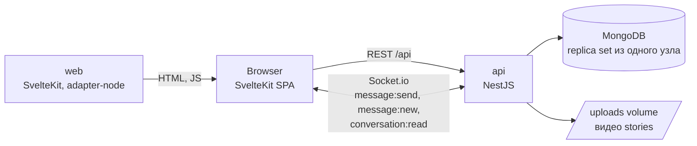
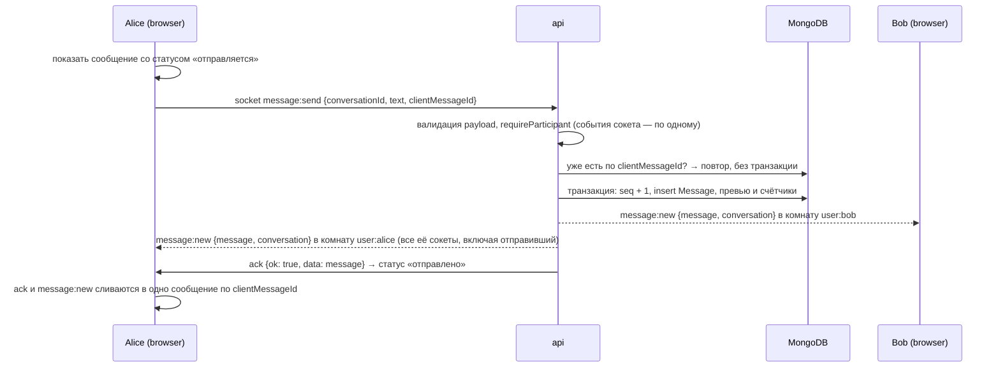

# Architecture

Как устроен проект и почему. Что строим и где границы — в [VISION.md](VISION.md), исходное
задание — в [TASK.md](TASK.md).

**Приоритеты** — как в VISION.md: всё, что не помечено, относится к P0. Разделы и пункты P1 и P2
помечены в заголовке или в тексте.

## Обзор



- **web** (`apps/web`, фронтенд) отдаёт SPA. Всё приложение работает в браузере
  (`ssr = false`), access-токен существует только там.
- **api** (`apps/api`, бэкенд) — один процесс NestJS: REST API, Socket.io gateway, cron очистки
  stories.
- **MongoDB** — replica set из одного узла (`rs0`), это всё тот же один контейнер. Replica set
  нужен ради транзакций: сообщение, его номер в диалоге, превью и счётчики непрочитанных
  меняются атомарно (см. «Сообщения и real-time»).
- Браузер ходит в API напрямую по `PUBLIC_API_URL`, бэкенд разрешает CORS для одного origin
  `CORS_ORIGIN`. Так одинаково работают и разработка, и Docker Compose.

## Стек

Версии проверены по npm на 31.10.2026, совместимость — по peer dependencies.

| Слой | Пакеты |
|---|---|
| Платформа | Node.js 24 LTS, pnpm 10 (workspace), TypeScript **6.0.3** |
| Backend | `@nestjs/*` 12.3, `@nestjs/mongoose` 12.0 + `mongoose` 9.11, `@nestjs/jwt` 12.0, `@nestjs/config` 12.0, `@nestjs/schedule` 12.0, `@nestjs/throttler` 6.7, `socket.io` 4.8.4, `class-validator` 0.15 + `class-transformer` 0.5, `multer` 2.5, `helmet` 8 |
| Frontend | `@sveltejs/kit` 3.1, `svelte` 5.57, `vite` 8.3, `@sveltejs/adapter-node` 6.0, `socket.io-client` 4.8.4, `tailwindcss` 4.3 |
| База | `mongo:8.0`, replica set из одного узла |
| Тесты | Backend: Jest 30, `supertest` 7, `mongodb-memory-server` 11 (`MongoMemoryReplSet`). Frontend: Vitest 5. В браузере: Playwright 1.64 (`apps/e2e`) |
| Качество | ESLint 10 + `typescript-eslint` 8, Prettier 3, `svelte-check` 4 |

**TypeScript 7 не берём:** SvelteKit требует `^6`, svelte-check — `^5 || ^6`, typescript-eslint —
`<6.1`, Nest CLI зафиксирован на `~6.0.2`.

**Хеширование паролей — `node:crypto` scrypt**, без нативных зависимостей (подробнее в разделе
«Пароли»).

## Структура репозитория

```
.
├── apps/
│   ├── api/                     NestJS (пакет `api`)
│   │   ├── src/
│   │   │   ├── main.ts
│   │   │   ├── app.module.ts
│   │   │   ├── app.setup.ts     префикс /api, CORS — общее для main.ts и e2e-тестов
│   │   │   ├── config/          схема и проверка env
│   │   │   ├── common/          toApiError и exception filter, валидация, escapeRegex, request-id
│   │   │   ├── health/          GET /api/health
│   │   │   ├── auth/            регистрация, вход, сессии и refresh, JWT guard, PasswordService
│   │   │   ├── users/           схема User, список и поиск
│   │   │   ├── conversations/   схема Conversation, find-or-create, список, проверка участника
│   │   │   ├── messages/        схема Message, отправка и «прочитано» в транзакциях, история
│   │   │   ├── realtime/        RealtimeService, ChatGateway, адаптер Socket.IO, ack-ошибки
│   │   │   ├── stories/         схемы Story и StoryView, загрузка, отдача, просмотры, cron очистки
│   │   │   └── seed/            демо-данные: пользователи и несколько диалогов (`pnpm seed`)
│   │   ├── test/                e2e (supertest + socket.io-client), setup, helpers
│   │   └── Dockerfile
│   ├── web/                     SvelteKit 3 (пакет `web`); конфиг Kit — в vite.config.ts
│   │   ├── src/
│   │   │   ├── env.ts           переменные окружения (defineEnvVars), импорт из $app/env/public
│   │   │   ├── lib/
│   │   │   │   ├── api/         fetch-обёртка, нормализация ошибок
│   │   │   │   ├── socket/      клиент Socket.io и store статуса соединения
│   │   │   │   ├── stores/      auth, conversations, messages, stories
│   │   │   │   ├── stories/     storyNavigation, videoUrls, запись (MediaRecorder), recordedWebm
│   │   │   │   ├── utils/       safeNext и прочее
│   │   │   │   └── components/  в т.ч. StoriesBar, StoryViewer
│   │   │   └── routes/
│   │   │       ├── (guest)/     login, register
│   │   │       └── (app)/       chats, chats/[id], users, stories/new
│   │   └── Dockerfile
│   └── e2e/                     Playwright: сценарии в браузере против Docker Compose
├── .github/workflows/ci.yml   lint, typecheck, unit-тесты, затем e2e
├── docker-compose.yml       весь проект
├── docker-compose.dev.yml   порт Mongo на 127.0.0.1 для локальной разработки
├── .env.example
├── docs/                    TASK.md, VISION.md, ARCHITECTURE.md
├── README.md
└── pnpm-workspace.yaml
```

## Модель данных

```
User
  _id, email (unique, trim + lowercase), username (как ввёл пользователь, для отображения),
  usernameLower (unique: уникальность и поиск без учёта регистра), passwordHash (select: false),
  createdAt

Conversation
  _id, participants: [ObjectId, ObjectId] (отсортированы), pairKey (unique) = "<idA>:<idB>",
  openedBy: [ObjectId] (кто открывал диалог; для показа пустых диалогов),
  seq: number (номер последнего сообщения в диалоге, 0 — сообщений нет),
  lastMessage { id, seq, senderId, text, createdAt } | null,
  lastMessageAt (= createdAt диалога, пока сообщений нет; затем createdAt последнего сообщения),
  unread: { <userId>: number } (P1: сколько сообщений собеседника пользователь не прочитал),
  lastReadSeq: { <userId>: number } (P1: до какого seq пользователь прочитал),
  createdAt, updatedAt
  индексы: { pairKey: 1 } unique, { participants: 1, lastMessageAt: -1, _id: -1 }

Message
  _id, conversationId, seq (1, 2, 3… внутри диалога, без пропусков), senderId,
  text (1..2000), clientMessageId (uuid), createdAt
  индексы: { conversationId: 1, seq: 1 } unique, { senderId: 1, clientMessageId: 1 } unique

Story
  _id, authorId, fileName, mimeType, sizeBytes, durationMs, createdAt, expiresAt
  индексы: { expiresAt: 1 } TTL (expireAfterSeconds: 3600), { authorId: 1, expiresAt: -1 }

StoryView
  _id, storyId, viewerId, expiresAt (= expiresAt истории), createdAt
  индексы: { storyId: 1, viewerId: 1 } unique, { viewerId: 1, storyId: 1 },
           { expiresAt: 1 } TTL (expireAfterSeconds: 3600)

Session
  _id (он же sessionId), userId, tokenHash (SHA-256 текущего refresh-токена), previousHash,
  rotatedAt, userAgent, lastUsedAt, createdAt, expiresAt
  индексы: { userId: 1 }, { expiresAt: 1 } TTL (expireAfterSeconds: 0)
```

**Инварианты**, которые держат транзакции:
- `Conversation.seq` равен наибольшему `Message.seq` в диалоге, номера идут без пропусков;
- `lastMessage` — сообщение с `seq = Conversation.seq`;
- (P1) `unread[u]` равен числу сообщений собеседника с `seq > lastReadSeq[u]`.

## Backend

### Сессии

Вход создаёт **сессию** (документ `Session`) и выдаёт два токена:

| Токен | Где живёт | Срок | Что хранит сервер |
|---|---|---|---|
| access: JWT с `sub`, `username`, `sid` | в памяти страницы, заголовок `Authorization: Bearer` | 15 минут | ничего сверх сессии: токен действует, пока жива его сессия |
| refresh: `<sessionId>.<секрет 256 бит>` | cookie `refresh_token`: `HttpOnly`, `SameSite=Strict`, `Path=/api/auth`, `Secure` по `COOKIE_SECURE` | 30 дней с последнего обновления | только SHA-256 секрета |

- **Ротация.** `POST /auth/refresh` заменяет refresh-токен одним условным `findOneAndUpdate`
  (`_id` + хеш текущего токена + срок не вышел). Из двух запросов с одним токеном выигрывает ровно
  один, гонки нет. Старый хеш остаётся в `previousHash`, время замены в `rotatedAt`.
- **Обнаружение повторного использования.** Пришёл токен, который уже заменён:
  - не позже `REFRESH_REUSE_GRACE_SECONDS` назад: это вторая вкладка, обновлявшаяся в тот же
    момент. Ей отдаётся только новый access-токен, без нового cookie (браузер уже получил его от
    первой вкладки);
  - раньше: токен утёк. Сессия удаляется целиком, сокеты закрываются, ответ `401` с
    `details.code = SESSION_REUSED`. Остальные отказы: `SESSION_INVALID`.
- **Выход.** `POST /auth/logout` (публичный: access-токен к этому моменту мог истечь) удаляет
  сессию по её refresh-токену и закрывает её сокеты (комната `session:<sid>` + `disconnectSockets`).
  Access-токены этой сессии перестают работать сразу: см. «Проверка сессии».
- **Проверка сессии.** `JwtAuthGuard` после проверки подписи вызывает `SessionService.exists(sid)`
  на каждом HTTP-запросе: сессии нет или она истекла — `401`. Это один `exists` по `_id`, то есть
  по первичному индексу. Подпись сама по себе пережила бы выход на срок токена, поэтому без этой
  проверки отзыв ждал бы до 15 минут.
- **Сокеты.** Токен проверяется при рукопожатии вместе с существованием сессии, поэтому новый
  сокет с токеном завершённой сессии не откроется. Уже открытые закрываются при выходе (см. выше).
  Сервер закрывает сокет, когда истекает его access-токен; клиент при каждом (пере)подключении запрашивает свежий
  токен и переподключается сам.
- **Чистка.** MongoDB удаляет просроченные сессии TTL-индексом.
- **Ограничение.** Выход завершает только текущую сессию. Списка устройств и «выйти везде» нет.

### Сквозные вещи

- **Конфигурация.** `ConfigModule` проверяет env через class-validator при старте и падает с
  понятной ошибкой, если переменной не хватает.
  Переменные: `MONGO_URI` (с `replicaSet=rs0` или `directConnection=true`, см. «Docker Compose»),
  `PORT`, `JWT_SECRET` (≥ 32 символа), `JWT_EXPIRES_IN` (срок access-токена, по умолчанию `15m`),
  `REFRESH_TOKEN_TTL_DAYS` (`30`), `REFRESH_REUSE_GRACE_SECONDS` (`10`), `COOKIE_SECURE`
  (`false`; `true` за HTTPS), `CORS_ORIGIN`, `UPLOADS_DIR` (`./uploads`), `MEDIA_TOKEN_TTL_SECONDS`
  (`300`), `AUTH_RATE_LIMIT_PER_MINUTE` (`10`), `TRUST_PROXY` (`0`: сколько прокси перед API, от
  этого зависит адрес клиента в лимите входа).
- **Валидация.** Глобальный `ValidationPipe({ whitelist: true, forbidNonWhitelisted: true,
  transform: true })`, DTO на class-validator. Id в параметрах проверяет `IsObjectIdPipe` из
  `@nestjs/mongoose`.
- **Ошибки — единый формат `ApiError` = `{ statusCode, error, message, details? }`.** В REST-ответе
  есть ещё `requestId` — тот же, что в заголовке `X-Request-Id` и в строке лога.
  - Его собирает одна функция `toApiError(exception)` в `common/errors/`:
    - ошибка дубликата ключа Mongo → `409`;
    - ошибки валидации → `400` с полями в `details`, `CastError` Mongoose → `400`;
    - всё непредвиденное → `500` без внутренностей наружу, с логом на сервере;
    - `error` — стандартное название статуса (`Bad Request`, `Conflict` и т.д.).
  - Её вызывают оба фильтра: HTTP exception filter отдаёт результат телом ответа, WS exception
    filter — в ack как `{ ok: false, error }`. Формат совпадает по построению, а не по договорённости.
  - На фронтенде и REST-ошибка, и ошибка из ack превращаются в один `ApiError`.
- **Авторизация.** Глобальный `JwtAuthGuard` с декоратором `@Public()` для открытых роутов,
  `@CurrentUser()` для текущего пользователя. Passport не используем: один и тот же
  `TokenService.verify()` работает и в HTTP guard, и при handshake сокета.
- **Rate limit — только на `POST /auth/register` и `POST /auth/login`.**
  - Ограничение: 10 запросов в минуту с одного адреса, число задаётся через env
    `AUTH_RATE_LIMIT_PER_MINUTE`.
  - `ThrottlerModule` подключён, но `ThrottlerGuard` не глобальный: он навешан
    `@UseGuards(ThrottlerGuard)` только на эти два метода.
  - `POST /auth/refresh` вызывается при каждой загрузке страницы и под лимит **не** попадает,
    как и `GET /auth/me`: иначе частые перезагрузки получали бы `429`.
  - В e2e-тестах лимит поднят через env, чтобы тесты не упирались в него. Отдельный тест
    проверяет сам лимит.

### Данные регистрации

| Поле | Правила |
|---|---|
| `email` | trim, lowercase, валидный email, до 254 символов. Уникален |
| `username` | trim, 3–24 символа, только `[a-zA-Z0-9_.]`. Уникален **без учёта регистра**: `Bob` и `bob` — один и тот же username |
| `password` | 8–128 символов (см. «Пароли») |

- **Как обеспечена уникальность username.** Сохраняется в двух полях: `username` — как ввёл
  пользователь, для отображения, и `usernameLower` с unique-индексом.
- **Почему только ASCII.** Для латиницы `toLowerCase()` однозначен. С Unicode пришлось бы решать
  case folding и похожие символы из разных алфавитов (латинская `a` и кириллическая `а`), иначе
  появятся неотличимые на глаз двойники.
- **Занятые email или username:** ответ `409` с полем в `details`, форма показывает ошибку у
  нужного поля.

### Пароли

`PasswordService` на `crypto.scrypt`:
- **Параметры:** `N = 2^15, r = 8, p = 3`, это вариант OWASP на 32 МиБ памяти. Ключ 64 байта, соль
  16 байт из `randomBytes`, `maxmem` 64 МиБ.
- **Формат хеша:** `scrypt$N=32768,r=8,p=3$<salt b64>$<hash b64>`. Параметры хранятся в самой
  строке, поэтому их можно поднять, и старые хеши продолжат проверяться.
- **Проверка:** сравнение через `timingSafeEqual`, пароль нормализуется в NFKC.
- **Защита от перебора аккаунтов:** для неизвестного email проверка всё равно идёт против
  фиктивного хеша. Ответ в обоих случаях одинаковый: `Invalid email or password`.
- **Длина пароля:** 8–128 символов, без требований к составу (NIST SP 800-63B).

### REST API

Все пути с префиксом `/api`. Открыты (`@Public()`) только `POST /auth/register`,
`POST /auth/login`, `POST /auth/refresh`, `POST /auth/logout` (им нужна refresh-cookie, а не
access-токен), `GET /health` и `GET /stories/:id/video` (доступ по подписанному `token` из
ссылки, см. «Отдача видео»). Всё остальное требует `Authorization: Bearer <token>`.

| Метод | Путь | Что делает |
|---|---|---|
| POST | `/auth/register` | `{ email, username, password }` → `{ accessToken, user }` |
| POST | `/auth/login` | `{ email, password }` → `{ accessToken, user }` |
| POST | `/auth/refresh` | refresh-cookie → `{ accessToken, user }` и новая cookie (ротация, см. «Сессии») |
| POST | `/auth/logout` | завершить сессию и удалить cookie; `204` |
| GET | `/auth/me` | текущий пользователь |
| GET | `/users?search=&cursor=&limit=` | все пользователи кроме себя, по алфавиту, страницами (`limit` 20 по умолчанию, до 50) → `{ items, nextCursor }`; `search` — подстрока в username без учёта регистра (см. «Пользователи») |
| GET | `/conversations` | мои диалоги, последние по активности первыми; у каждого `unreadCount` (P1) |
| POST | `/conversations` | `{ userId }` → найти или создать диалог (`200` или `201`) |
| GET | `/conversations/:id` | один диалог (открытие по ссылке, обновление после реконнекта) |
| GET | `/conversations/:id/messages?before=&after=&limit=` | история; `before=<seq>` — страница назад, `after=<seq>` — догрузка пропущенного. Ответ `{ items, nextCursor }`, как у `/users`: `items` всегда от старых к новым, `nextCursor` — `seq` для следующего `before` (самое старое на странице) или `after` (самое новое), `null` — дальше ничего нет |
| POST | `/conversations/:id/messages` | `{ text, clientMessageId }` → сообщение. Тот же `MessagesService.send()`, что и у сокета; основной путь отправки — сокет |
| POST | `/conversations/:id/read` | (P1) `{ seq }` → `{ lastReadSeq, unreadCount }`. Тот же сервис, что и событие сокета `conversation:read` |
| POST | `/stories` | multipart: `video`, `durationMs` |
| GET | `/stories/feed` | авторы с активными историями и их истории, у каждой `seen` |
| POST | `/stories/:id/view` | отметить историю просмотренной (идемпотентно); `204` |
| GET | `/stories/:id/playback` | подписанная ссылка на видео |
| GET | `/stories/:id/video?token=` | файл видео с поддержкой Range; без `Authorization`, по токену из ссылки |
| DELETE | `/stories/:id` | удалить свою историю |
| GET | `/health` | проверка живости для Docker |

Диалог в ответах (`ConversationDto`) показывается с точки зрения того, кто спрашивает:
`{ id, peer, lastMessage, unreadCount, lastMessageAt, createdAt }`.

### Диалоги

- **Find-or-create.** `pairKey` — отсортированная пара id. Один `findOneAndUpdate` с `upsert` по
  `pairKey`: `$setOnInsert` заполняет новый диалог, `$addToSet` отмечает открывшего. Если два
  человека нажали «написать» одновременно и вставка проиграла уникальный индекс, ловим duplicate
  key и повторяем тот же upsert — теперь он находит созданный диалог. `201` — диалог создан,
  `200` — уже был.
- **Нельзя написать самому себе:** `400`. Несуществующий собеседник: `404`.
- **Проверка доступа.** `requireParticipant(conversationId, userId)` стоит перед каждой операцией с
  диалогом и его сообщениями. Чужой диалог — `403`, несуществующий — `404`.
- **Пустые диалоги.** Диалог без сообщений виден только тем, кто его открывал, чтобы у собеседника
  не появлялись пустые диалоги от чужих кликов.
  - Каждый `POST /conversations` делает `$addToSet: { openedBy: me }`, и для нового, и для уже
    существующего диалога. Если Боб когда-то открыл пустой диалог с Алисой, а теперь его
    открывает Алиса, диалог появится и в её списке.
  - При создании `lastMessageAt = createdAt`, поэтому только что открытый диалог встаёт в начало
    списка.
- **Список диалогов** — `GET /conversations`, отдаётся целиком (у пользователя тестового
  проекта их десятки), без пагинации:
  - фильтр `{ participants: me, $or: [{ lastMessage: { $ne: null } }, { openedBy: me }] }`;
  - сортировка `{ lastMessageAt: -1, _id: -1 }`, `_id` разрешает равенство времени;
  - обе части запроса покрывает индекс `{ participants: 1, lastMessageAt: -1, _id: -1 }`.
  - У собеседника диалог появляется с первым сообщением: `message:new` несёт и сообщение, и
    сам диалог с его точки зрения, отдельный запрос не нужен.

### Пользователи

`GET /users?search=&cursor=&limit=` — это и «список всех пользователей», и поиск: `search`
только сужает тот же список.

- **Себя в списке нет.** Список нужен, чтобы начать диалог, а диалог с собой запрещён (`400`).
  Свой профиль доступен через `GET /auth/me`.
- **Отдаются только публичные поля** `{ id, username, createdAt }`. Email других пользователей не
  отдаётся никогда.
- **Порядок** — по алфавиту без учёта регистра (`usernameLower`).
- **Пагинация курсорная**, ответ `{ items, nextCursor }`:
  - `limit` по умолчанию 20, допустимо 1–50, вне диапазона — `400`;
  - `cursor` — `usernameLower` последнего пользователя на странице, следующая страница —
    `usernameLower > cursor`;
  - `nextCursor: null` — дошли до конца;
  - `usernameLower` уникален, поэтому курсор не даёт ни пропусков, ни дублей.
- **«Все» — значит все.** На фронтенде под списком кнопка «Показать ещё», она дозапрашивает
  страницы по `nextCursor`, пока он не станет `null`.
- **Поиск — по подстроке.** `ob` находит `bob` и `Bobby`.
  - Запрос: regex `escapeRegex(search.trim().toLowerCase())` без якоря `^` по полю
    `usernameLower`. `escapeRegex` нужен, чтобы через ввод нельзя было подсунуть свой regex.
  - `search` — 1–24 символа, управляющие символы отклоняются. Пустой `search` — весь список.
  - Пагинация та же: курсор и фильтр по подстроке применяются вместе.
  - **Цена:** regex без якоря не может сузить поиск по индексу, поэтому Mongo просматривает все
    значения `usernameLower`. Для тестового объёма это миллисекунды; на миллионах пользователей
    нужен поиск по n-граммам или Atlas Search (см. «Известные ограничения»).

### Сообщения и real-time



- **Отправка и доставка — через сокет**, как требует ТЗ. Отправка — событие `message:send` с
  ack: клиент получает либо сохранённое сообщение, либо ошибку в том же формате, что и REST.
- **REST остаётся для истории** (`GET .../messages`) и как запасной путь отправки. Оба пути
  вызывают один `MessagesService.send()`, поэтому логика и проверки не дублируются.
- **Порядок сообщений — по `seq`**: номер внутри диалога, который выдаёт транзакция. Сортировка
  истории, курсоры `before` и `after` и обнаружение пропусков на клиенте работают по `seq`.

**Отправка** (`MessagesService.send()`):

1. **До транзакции:** `requireParticipant` и поиск по `(senderId, clientMessageId)`. Если
   сообщение уже есть, это повтор: транзакция не открывается, сообщение рассылается заново и
   возвращается. Если тот же `clientMessageId` использован в другом диалоге — `409`.
2. **Транзакция** (`connection.transaction()`; Mongoose сам повторяет её при
   `TransientTransactionError`):
   1. `findOneAndUpdate(conversation, { $inc: { seq: 1 } })` → новый `seq`;
   2. `insert` сообщения с этим `seq`;
   3. `findOneAndUpdate(conversation)` (возвращает диалог в том виде, в каком он будет закоммичен,
      поэтому рассылке не нужно читать его заново): `lastMessage`, `lastMessageAt`;
      (P1) `$inc unread.<получатель>`,
      `unread.<отправитель> = 0` и `$max lastReadSeq.<отправитель> = seq` — ответив, ты прочитал
      всё, что было до этого.
3. **Гонка повторов:** если транзакция упала на уникальном индексе `clientMessageId` (тот же
   повтор пришёл с другого соединения и успел раньше), читаем сохранённое сообщение и действуем
   как при повторе.
4. **После коммита** `message:new` уходит каждому участнику отдельно, с диалогом с его точки
   зрения (свой собеседник, свой `unreadCount`). Рассылка только после коммита: событие о
   сообщении, которого нет в базе, не уйдёт никогда.

**Что дают транзакции.**
- **Параллельные отправки в один диалог** обе меняют `seq` одного документа. Получается
  конфликт записи, одна транзакция откатывается и повторяется с новым `seq`. Номера идут без
  пропусков, превью и счётчики всегда соответствуют последнему номеру.
- **Сбой посреди отправки** не оставляет половину: либо есть сообщение, номер, превью и
  счётчики, либо нет ничего, и клиент повторит отправку с тем же `clientMessageId`.
- **Порядок отправок одного автора** держит адаптер Socket.IO: `IoAdapter` из Nest 12 с
  `maxConcurrentMessages: 1` обрабатывает события одного типа от одного сокета строго по одному.
  Иначе два быстрых сообщения могли бы получить `seq` в порядке коммита, а не в порядке набора.
  Своя очередь не нужна; тест на порядок падает, если снять это ограничение.

### Счётчик непрочитанных (P1)

- **Определение:** `unread[u]` — число сообщений собеседника с `seq > lastReadSeq[u]`. Хранится
  в диалоге, чтобы список диалогов не считал его запросом на каждый диалог.
- **Растёт** в транзакции отправки: `$inc unread.<получатель>`.
- **Сбрасывается**, когда пользователь читает диалог: событие сокета
  `conversation:read { conversationId, seq }` с ack (или `POST /conversations/:id/read`).
  Транзакция:
  1. `target = min(seq, Conversation.seq)` — нельзя «прочитать» то, чего ещё нет;
  2. если `target <= lastReadSeq[u]` — ничего не меняем: маркер прочтения только растёт;
  3. `unread = target === Conversation.seq ? 0 :` число сообщений собеседника с `seq > target`
     (по индексу `{ conversationId, seq }`);
  4. записываем `lastReadSeq[u] = target` и `unread[u]`.
- **Почему тоже транзакция:** если между чтением счётчика и записью придёт новое сообщение, без
  транзакции его `$inc` потерялся бы. С транзакцией получается конфликт записи и повтор.
- **Синхронизация вкладок:** после изменения сервер шлёт
  `conversation:read { conversationId, lastReadSeq, unreadCount }` в комнату `user:<u>`. Прочитал
  в одной вкладке — счётчик сбросился во всех.
- **Когда клиент отмечает прочитанным:** экран диалога открыт и вкладка видима
  (`document.visibilityState === 'visible'`). Отметка уходит после загрузки диалога, на каждое
  новое сообщение в нём и при возвращении на вкладку, с debounce 300 мс и последним известным
  `seq`.
- **Где видно:** бейдж с числом у диалога в списке. Свой диалог, открытый на экране, не
  получает бейдж: сообщение сразу отмечается прочитанным.
- **Отметки о прочтении у собеседника** («галочки») не показываем. `lastReadSeq` для этого уже
  есть, так что они добавляются без изменения модели.

### Гарантии доставки

**Гарантия:** каждое сохранённое сообщение появляется у участника, у которого открыто
приложение, без перезагрузки страницы — сразу или, в худшем случае, после переподключения
сокета, — и показывается ровно один раз.

**Как это обеспечено:**
1. **Рассылка после коммита.** `message:new` уходит только для сообщений, которые уже в базе.
2. **Пропуски видны по `seq`.** Номера в диалоге идут без пропусков, поэтому клиент знает
   последний непрерывный `seq` каждого загруженного диалога. Если пришло сообщение с номером
   больше ожидаемого, клиент ждёт до 1 секунды (события двух параллельных коммитов могут прийти в
   обратном порядке) и догружает `GET .../messages?after=<последний непрерывный seq>`.
3. **Переподключение.** После `connect` клиент перечитывает список диалогов (превью, порядок,
   счётчики) и догружает каждый загруженный диалог с `after=<последний непрерывный seq>`.
4. **Отправитель.** Пропал ack — сообщение `failed`, повтор с тем же `clientMessageId` вернёт уже
   сохранённое и разошлёт его заново.
5. **Дубли** при повторной рассылке отбрасываются на клиенте по `clientMessageId` и `seq`.

**Почему разрыв «сохранили, но не разослали» закрыт.** Бэкенд — один процесс. Если он упал между
коммитом и рассылкой, вместе с ним оборвались все сокеты. Каждый клиент переподключится и
догрузит пропущенное по пункту 3. Ситуации, в которой сокет получателя жив, а событие потеряно,
в нашей схеме нет. Транзакция гарантирует, что догрузка увидит согласованные данные: сообщение,
номер, превью и счётчики вместе.

**Когда этого станет мало.** С несколькими репликами бэкенда реплика может упасть после коммита,
а сокет получателя останется жив на другой реплике. Он не переподключится и заметит пропуск
только по следующему сообщению. Тогда нужен **transactional outbox**: событие пишется в отдельную
коллекцию в той же транзакции, а рассылкой занимается процесс, который читает её через change
stream. Replica set для этого у нас уже есть, но при одном процессе outbox решал бы проблему,
которой нет. Записано в «Известных ограничениях».

**Gateway** (`realtime/`, модуль `ChatModule` отдельно от `RealtimeModule`: тому нужен модуль
сообщений, а gateway — ему, и в одном модуле зависимость стала бы циклической):
- **Адаптер.** `ChatIoAdapter` подключается в `configureApp`: берёт `CORS_ORIGIN` из конфига при
  старте (декоратор `@WebSocketGateway` читается раньше конфига) и задаёт
  `maxConcurrentMessages: 1`.
- **Handshake.** Токен в `handshake.auth.token` проверяется в middleware `server.use()`. При
  отказе клиент получает ошибку с `data.code`: `UNAUTHORIZED` (токен или сессия недействительны),
  `TOKEN_EXPIRED` или `UNAVAILABLE` (проверить сессию не удалось, например база недоступна: это
  не повод выходить, ошибка пишется в лог).
- **Комнаты.** Каждый сокет входит в комнату `user:<userId>`. Одно событие доходит до всех вкладок
  пользователя, включая сокет, который отправил сообщение: он получает и ack, и `message:new`.
  Сокет-отправитель из рассылки не исключаем: REST-отправка идёт без сокета, и обе ветки
  проще держать одинаковыми. Дубль гасится слиянием по `clientMessageId`.
- **`RealtimeService.emitToUsers(ids, event, payload)`.** Сервисы отправляют события, не зная о
  gateway.
- **Сервер → клиент:**
  - `message:new { message, conversation }` — каждому участнику свой `conversation`;
  - (P1) `conversation:read { conversationId, lastReadSeq, unreadCount }` — во вкладки того,
    кто прочитал;
  - `story:created { story, author }` — готовые данные, клиент добавляет историю без перезапроса ленты;
  - `story:deleted { storyId, authorId }`.
- **Клиент → сервер** (ответ всегда в ack: `{ ok: true, data } | { ok: false, error: ApiError }`,
  где `ApiError` — тот же объект, что в REST: `{ statusCode, error, message, details? }`):
  - `message:send { conversationId, text, clientMessageId }` → `data: Message`;
  - (P1) `conversation:read { conversationId, seq }` → `data: { lastReadSeq, unreadCount }`.
- **Валидация payload.** DTO на class-validator и тот же `ValidationPipe` на gateway. Ошибки
  ловит WS exception filter и возвращает их в ack, а не роняет соединение. Чужой диалог — `403`
  в ack, как и в REST.
- **Лимит.** Простой счётчик в памяти: не больше 10 `message:send` и 10 `conversation:read` в
  секунду на сокет, сверх — `429` в ack.

**Отправка на клиенте.**
- `socket.timeout(5000).emitWithAck('message:send', ...)`.
- Нет ack за 5 секунд или сокет отключён → статус `failed` с кнопкой «повторить».
- Повтор идёт с тем же `clientMessageId`, поэтому дубль не появится, даже если первая попытка
  на самом деле дошла.
- **(P1)** Сообщения в статусе `failed` по сетевой причине (нет ответа) после переподключения
  автоматически отправляются заново по одному, в исходном порядке, с прежним `clientMessageId`;
  если связи всё ещё нет, цепочка останавливается до следующего переподключения. Отказы сервера
  (403 и т. п.) не повторяются. В P0 повтор только по кнопке «повторить».

### Stories (P2)

**Загрузка** — `POST /stories`, multipart:
- лимит 20 МБ; multer пишет файл потоком в `UPLOADS_DIR/.incoming` (в память видео не попадает), при превышении лимита обрывает приём и удаляет частичный файл;
- тип файла определяется по первым байтам (`detectVideoType`: заголовок EBML с типом `webm` или
  блок `ftyp` у MP4), допустимы MP4 (Chrome, Safari) и WebM (Firefox). Своя проверка на 20 строк
  вместо пакета `file-type`: тот распространяется только как ESM, а нужны всего два формата;
- `durationMs` в пределах 1..15 500, проверяется по значению от клиента: обрабатывать видео на
  сервере ТЗ запрещает;
- тип читается по первым 64 байтам файла; после проверок файл переименовывается в `UPLOADS_DIR/<storyId>.<ext>` (rename внутри одного каталога, не копия), затем создаётся документ. При любой ошибке принятый файл удаляется (`DiscardUploadOnError`), а cron раз в 5 минут убирает из `.incoming` файлы старше часа, оставшиеся после падения процесса.

**Хранилище** — интерфейс `StoryStorage` (`save` из принятого файла, `open` с диапазоном, `delete`, `deleteStaleIncoming`) с реализацией на локальном
диске. В Docker это volume `uploads`. S3 при необходимости подключается второй реализацией.

**Отдача видео:**
- `GET /stories/:id/playback` закрыт, как все остальные эндпоинты, и отдаёт `{ videoUrl, expiresAt }`. Ссылку клиент запрашивает при открытии истории, а не вместе с лентой;
- в ссылке `?token=` — JWT с отдельным `audience` и `{ story: id }`, срок `min(MEDIA_TOKEN_TTL_SECONDS, остаток жизни истории)`. Пользователя в токене нет: смотреть может любой вошедший, лента общая. Access-токен вместо него не подойдёт и наоборот;
- `GET /stories/:id/video?token=` публичный, доступ определяется токеном; отдаётся только активная история;
- Range: `bytes=a-b`, `a-` и `-n` дают `206` с `Content-Range`, неудовлетворимый диапазон — `416`, некорректный или множественный игнорируется (весь файл, `200`). Разбор вынесен в `parseRange` с юнит-тестами;
- файл не меняется под своим id, поэтому `ETag` — id истории: `If-None-Match` даёт `304`, устаревший `If-Range` — полный файл. `Cache-Control: private, max-age` не больше остатка жизни истории и не больше часа;
- клиент отдаёт ссылку в `<video src>`, браузер сам делает Range-запросы. Ссылка перезапрашивается заранее, если живёт менее 10 секунд; ошибку воспроизведения viewer один раз молча лечит новой ссылкой, и только потом показывает сообщение. Следующая история подгружается скрытым `<video preload="auto">`.

**Автоудаление:**
- каждый запрос фильтрует `expiresAt > now`, так что история исчезает из выдачи ровно через 24 часа;
- cron `@nestjs/schedule` раз в 5 минут находит истёкшие истории, удаляет файл, затем документ;
- TTL-индекс с запасом в 1 час — подстраховка, если cron не отработал. Сам по себе он удаляет
  только документ, файл остался бы на диске, поэтому основной механизм — cron.

**Лента** — `GET /stories/feed`:
- активные истории, сгруппированные по автору, внутри группы от старых к новым;
- первыми идут свои истории, затем остальные по свежести;
- `story:created` несёт историю и автора, `story:deleted` — `storyId` и `authorId`: клиент правит ленту на месте.
- Лента ограничена `FEED_LIMIT = 200` свежих историй. Просмотры — коллекция `story_views` (уникальна пара история+зритель), `POST /stories/:id/view` идемпотентен; у историй в ленте есть `seen`, у своих всегда `true`.

**Запись (web):**
- `getUserMedia` → `MediaRecorder`, формат выбирается через `MediaRecorder.isTypeSupported`:
  сначала MP4 с H.264 и AAC — его пишут Chrome и Safari, проигрывают все браузеры, и длительность
  в нём уже есть; WebM только для Firefox, который MP4 не пишет;
- таймер на экране, автоматическая остановка в 15 секунд;
- WebM перед отправкой чинится (`recordedWebm.ts`), без перекодирования и без зависимостей:
  - дописывается длительность в блок `Info`: браузеры её не пишут;
  - всем звуковым блокам ставится флаг ключевого кадра. Firefox его не ставит, а Chrome по
    этому флагу ищет, куда перемотать файл без индекса, и падает с `demuxer seek failed`.
    Перемотку на 0 Chrome делает и сам, когда возобновляет «усыплённое» видео на паузе, так что
    без флага ролик из Firefox в Chrome показывал чёрный экран. Кадры Opus независимы, флаг
    верен для каждого;
  - остальные байты не меняются, «неизвестные» размеры сегмента и кластеров тоже. Пакет
    `fix-webm-duration` не подошёл: он переписывает их в известные и вкладывает все кластеры
    в первый, ffmpeg такой файл считает битым, а флаги звука он не трогает;
- превью ролика перед публикацией, камера выключается при уходе со страницы.

**Просмотр (web):**

- **Где.**
  - Над списком диалогов на `/chats` горизонтальная лента `StoriesBar`: первым идёт кружок «Ваша
    история» с `+` (ведёт на `/stories/new`), дальше авторы с активными историями.
  - Клик по автору открывает `StoryViewer` — полноэкранный модальный `<dialog>` поверх страницы.
    Отдельного маршрута нет: просмотр — короткое действие, а `<dialog>` бесплатно даёт фокус
    внутри окна, закрытие по `Esc` и возврат фокуса на кнопку, которая его открыла.
- **Что видно.**
  - Видео на весь экран в пропорции 9:16.
  - Сверху полоски прогресса, по одной на каждую историю автора.
  - Имя автора и сколько времени назад опубликовано.
  - Кнопки «пауза» и «закрыть», у своей истории — «удалить» с подтверждением.
- **Порядок.**
  - Истории автора идут от старых к новым, после последней — следующий автор в ленте, после
    последнего автора окно закрывается.
  - При открытии берётся снимок ленты: если по сокету придёт новая история, просмотр не
    перескочит.
- **Управление.**
  - Конец ролика (`ended`) — следующая история.
  - Клик по левой трети экрана — предыдущая, по правой части — следующая.
  - Клавиатура: `←` и `→`, `Space` — пауза, `Esc` — закрыть.
- **Загрузка видео.**
  - Для каждой истории запрашивается подписанная ссылка (`GET /stories/:id/playback`, кеш в
    `videoUrls.ts`), она идёт прямо в `<video src>`. Браузер сам качает ролик Range-запросами,
    целиком в память он не загружается (см. «Отдача видео»).
  - Пока ссылки нет — надпись «Loading…». Ссылка на следующую историю берётся заранее, а скрытый
    `<video preload="auto">` начинает её грузить, чтобы переход был без паузы.
  - Ссылка, которой до истечения меньше 10 секунд, запрашивается заново.
- **Подводные камни.**
  - **Прогресс считается по `durationMs` из документа истории**, а не по `video.duration`:
    у WebM без длительности он `Infinity`, а старые записи могли остаться такими.
  - **Автовоспроизведение со звуком браузер может запретить** (`NotAllowedError`), потому что
    видео стартует уже после асинхронного запроса ссылки, а не прямо по клику. Тогда играем без звука и
    показываем кнопку «включить звук».
- **Ошибки.**
  - История истекла или удалена, пока её открывали (`404`) — переходим к следующей.
  - Ошибка сети — сообщение и кнопка «повторить».
  - Ошибка воспроизведения: один раз молча берём новую ссылку (старая могла истечь), повторная
    ошибка — сообщение, стрелки по-прежнему листают дальше.
- **Просмотренное.** Открытая история сразу помечается просмотренной в сторе (`markSeen`) и
  отправляется `POST /stories/:id/view`; неудачный запрос не повторяется. В `StoriesBar` у автора
  с непросмотренными историями цветное кольцо, когда все просмотрены — серое. Порядок ленты от
  этого не зависит: свои истории первыми, остальные по свежести.
- **Логика переходов** (следующая и предыдущая история, переход между авторами) вынесена в чистую
  функцию `storyNavigation.ts` и покрыта unit-тестом. Компонент только вызывает её.

## Frontend

### Маршруты

| Маршрут | Что там |
|---|---|
| `/` | редирект на `/chats` |
| `(guest)/login`, `(guest)/register` | формы входа и регистрации; если уже вошёл — редирект в приложение |
| `(app)/chats` | лента stories (`StoriesBar`) и список диалогов с бейджами непрочитанных (P1); просмотр историй — модальный `StoryViewer` поверх страницы (см. «Stories → Просмотр») |
| `(app)/chats/[id]` | экран диалога; пока он открыт и вкладка видима, новые сообщения отмечаются прочитанными (P1) |
| `(app)/users` | все пользователи, поиск с debounce, «Показать ещё», кнопка «написать» |
| `(app)/stories/new` | запись истории |

- **Всё приложение работает в браузере:** `ssr = false` в корневом `+layout.ts`, потому что
  access-токен живёт в памяти браузера, а refresh-cookie принадлежит origin API, поэтому сервер,
  отдающий страницы, не может определить пользователя.
- **Защита роутов.** `(app)/+layout.ts`: если `POST /auth/refresh` вернул `401` (cookie нет или отозвано), происходит
  редирект на `/login?next=...`. Если сервер недоступен — `503` и страница `+error.svelte` с
  кнопкой «Try again». `(guest)/+layout.ts` уводит уже вошедшего пользователя дальше.
- **`next`** принимается только как путь внутри приложения (`safeNext`), чтобы через него не
  уводили на чужие сайты.
- **Особенности Kit 3:**
  - вместо `$lib` — Node subpath import `#lib` из `"imports"` в `package.json`, импорты `.ts`
    пишутся с `.js` (`#lib/app.js`);
  - `resolve()` из `$app/paths` принимает id маршрута с группой: `resolve('/(app)/chats')`.
    Правило ESLint `svelte/no-navigation-without-resolve` требует его в каждом `href` и `goto`;
  - состояние страницы — из `$app/state`, переменные окружения — из `$app/env/public`.
- **Сборка зависимостей.** Stores принимают зависимости аргументами (`createMessagesStore(transport,
  …)`), поэтому их unit-тесты не требуют браузера и сервера. Единственные экземпляры и связка с
  сокетом — в `lib/app.ts`.

### Состояние

Svelte stores на `writable` и `derived`, как требует ТЗ. Руны — только для локального состояния
компонентов.

| Store | Что хранит |
|---|---|
| `auth` | `{ status, user }`, access-токен только в памяти. При загрузке страницы `init()` получает его из refresh-cookie (`POST /auth/refresh`). Обновление одно за раз: внутри вкладки общий промис, между вкладками Web Lock `chat.refresh`. `logout()` стирает состояние сразу и завершает сессию на сервере в фоне |
| `conversations` | список диалогов, `loading` и `error`. На `message:new` диалог заменяется присланным с сервера (превью, порядок, `unreadCount`), новый диалог добавляется. Копия с меньшим `lastMessage.seq` старую не заменяет: события могут прийти не по порядку, а время у двух сообщений может совпасть до миллисекунды. На `conversation:read` обновляется `unreadCount` (P1) |
| `messages` | `Record<conversationId, { items, status, error, hasMore, loadingOlder }>`; сообщения упорядочены по `seq`, неподтверждённые — в конце в порядке набора; статусы `sending`, `sent`, `failed`; слияние по `clientMessageId`; обнаружение пропуска в `seq` (`contiguousSeq`) и догрузка `after`; догрузка истории назад по `before`. Неудачная перезагрузка уже открытого диалога не прячет его сообщения, в том числе неотправленные |
| `socket.status` | статус сокета: `idle`, `connecting`, `online`, `offline` — для баннера «Connection lost». На каждое подключение `lib/app.ts` перечитывает список диалогов и ленту stories, догружает открытые диалоги и (P1) заново отправляет их сообщения, не ушедшие из-за сети |
| `stories` | лента с `seen` у каждой истории, `loading` и `error`; обновляется на `story:*`, `markSeen()` отмечает историю сразу и шлёт `POST /stories/:id/view` |

- **`api/http.ts`.** `fetch` с базовым URL и токеном, `credentials: 'include'` для cookie. На `401`
  к запросу с токеном просит `auth.renew()` новый токен и повторяет запрос один раз; нового токена
  нет — выход. Ошибки бэкенда превращаются в `ApiError` с
  `status`, `message` и `details`, чтобы формы показывали ошибки у конкретных полей.
- **`socket/client.ts`.** Подключается после входа, отключается при выходе. Токен для рукопожатия
  берёт функцией при каждом подключении. Сервер закрыл сокет (токен истёк): подключается снова. На
  `connect_error` с `UNAUTHORIZED` выполняет выход, с `TOKEN_EXPIRED` (не удалось получить новый
  токен: нет сети) и `UNAVAILABLE` (сервер не смог проверить сессию) повторяет через 3 секунды. Даёт `request(event, payload)` поверх
  `emitWithAck` с таймаутом; ошибку из ack превращает в тот же `ApiError`, что и REST.

### Хранение токенов

Access-токен лежит только в памяти, refresh-токен только в HttpOnly-cookie. Refresh-токен XSS
прочитать не может. Access-токен в памяти JS ему доступен (например, через перехват `fetch`), но
не лежит в storage, не переживает закрытие вкладки, живёт 15 минут и перестаёт работать сразу
после выхода (guard проверяет сессию): XSS может действовать лишь от имени открытой страницы и
недолго. От CSRF
cookie защищают `SameSite=Strict`, `Path=/api/auth` и CORS с единственным разрешённым origin.
Web и API должны быть на одном сайте (например, `localhost:5173` и `localhost:3000`).

## Docker Compose (P1)

| Сервис | Образ | Порт | Что делает |
|---|---|---|---|
| `mongo` | `mongo:8.0` | наружу не публикуется | replica set `rs0` из одного узла, данные в volume `mongo-data` |
| `api` | `apps/api/Dockerfile` (multi-stage, `node:24-alpine`) | 3000 | ждёт healthcheck Mongo; `uploads` в volume |
| `web` | `apps/web/Dockerfile` (multi-stage, `node:24-alpine`) | 5173 | `node build` |

- `docker compose up --build` поднимает всё. Значения по умолчанию лежат в `docker-compose.yml`,
  `.env` нужен только для переопределения (в том числе портов: `API_PORT`, `WEB_PORT`).
- **Образы.** Сборка в отдельной стадии, затем `pnpm deploy --prod` собирает только
  production-зависимости пакета. В итоговый образ попадают `package.json`, `node_modules` и
  сборка (`dist` или `build`); процесс работает от пользователя `node`. Порядок запуска держат
  healthcheck'и: `mongo` → `api` (`/api/health`) → `web`.
- **`PUBLIC_API_URL`** фронтенд читает при старте сервера, а не при сборке, поэтому один образ
  работает с любым адресом API.
- **Replica set из одного узла:**
  - `mongod --replSet rs0 --bind_ip_all`;
  - healthcheck через `mongosh` при первом старте выполняет
    `rs.initiate({ _id: 'rs0', members: [{ _id: 0, host: 'mongo:27017' }] })`, дальше просто
    проверяет `rs.status()`. Сервис `api` стартует только после `service_healthy`;
  - `MONGO_URI=mongodb://mongo:27017/chat?replicaSet=rs0`;
  - `--setParameter transactionLifetimeLimitSeconds=10`: если процесс бэкенда упадёт посреди
    транзакции, незавершённая транзакция держит блокировку диалога до этого лимита (по умолчанию
    60 секунд), и отправки в этот диалог после рестарта ждали бы всё это время.
  - **Ядро Linux 6.19+.** По опыту эталона mongod 8.0.30+ не стартует на хостах с таким ядром
    (SERVER-121912), обходной путь — `GLIBC_TUNABLES=glibc.pthread.rseq=1`. На шаге 1 проверено
    на Docker Desktop для macOS (ядро 6.12): replica set поднимается, транзакции работают,
    обходной путь не нужен. Проверить на Linux-хосте с ядром 6.19+ пока не на чем.
- **Демо-секрет.** `JWT_SECRET: ${JWT_SECRET:-local-demo-secret-change-me-please}` —
  значение по умолчанию прямо в `docker-compose.yml`, чтобы проект запускался без ручных шагов.
  README прямо оговаривает: секрет только для локального запуска, для любого другого окружения
  задайте свой в `.env` (не короче 32 символов, например `openssl rand -base64 48`).
- **Для разработки:** `pnpm db:up` поднимает только Mongo с портом на `127.0.0.1`, затем
  `pnpm dev` запускает бэкенд и фронтенд в watch-режиме. С хоста подключаемся с
  `MONGO_URI=mongodb://127.0.0.1:27017/chat?directConnection=true`: участник replica set
  зарегистрирован под именем `mongo:27017`, которое с хоста не резолвится, а `directConnection`
  говорит драйверу не искать других участников.

## Тесты (P1)

| Уровень | Что проверяем |
|---|---|
| Backend unit (Jest) | `PasswordService` (верный и неверный пароль, испорченный хеш), `toApiError`, `escapeRegex`, проверка env, `SocketRateLimiter`, `parseRange`, `detectVideoType` |
| Backend e2e (Jest + supertest + `MongoMemoryReplSet`) | регистрация, вход и дубликаты (`Bob` после `bob` → `409`, недопустимые символы в username → `400`); `401` без токена на любом закрытом эндпоинте, включая видео stories; `/health` без токена → `200`; rate limit: 11-й `login` за минуту → `429`, а `GET /auth/me` сверх лимита — по-прежнему `200`; пользователи (себя нет, email чужих нет, обход всех страниц по курсору без пропусков и дублей, `limit` вне 1–50 → `400`) и поиск (подстрока, без учёта регистра, спецсимволы regex ищутся как обычный текст); диалоги: без дублей, нельзя с собой, чужой диалог `403`, пустой диалог виден только открывавшим (в том числе когда второй открыл его позже), порядок по `lastMessageAt`; сообщения: 20 параллельных отправок → `seq` 1..20 без пропусков, превью — сообщение с `seq` 20, повтор по `clientMessageId` не создаёт нового номера и рассылает сообщение заново, тот же `clientMessageId` в другом диалоге → `409`, история по `before` и догрузка по `after`; (P1) непрочитанные: у получателя растут, ответ обнуляет свои, прочтение до `seq` k даёт верный остаток, маркер не идёт назад, прочтение параллельно с отправками сохраняет инвариант `unread == число непрочитанных сообщений`, `conversation:read` приходит во вторую вкладку; формат ошибки одинаков в REST и в ack (есть `error`); сокет: отказ без токена, `message:send` → ack с сообщением и `message:new` у собеседника с его `conversation`, невалидный payload и чужой диалог → ошибка в ack; stories: проверка типа, лента, истёкшие не отдаются, cron удаляет файл; сессии: ротация refresh-cookie, гонка вкладок в пределах grace, повтор заменённого токена завершает сессию, выход закрывает REST и сокеты только этой сессии; request-id и заголовки безопасности. Find-or-create, в том числе одновременное открытие с двух сторон, проверяется здесь, а не unit-тестом |
| Frontend unit (Vitest) | store `messages` (мгновенное отображение, слияние по `clientMessageId`, порядок по `seq`, ошибка, пропуск в `seq` → догрузка `after` после ожидания, сообщение, обогнавшее соседа, догрузку не вызывает, автоповтор после переподключения), store `conversations` (замена диалога на `message:new`, сброс `unreadCount` на `conversation:read`), stores `auth` и `stories`, `api/http` (разбор ошибок, повтор после `401`), `safeNext`, `storyNavigation` (переходы внутри автора и между авторами, края ленты), `videoUrls`, `recordedWebm` |
| Browser e2e (Playwright, Chromium) | `apps/e2e` против поднятого Docker Compose: регистрация, вход и выход, ошибки форм, редирект на вход и обратно, сессия переживает перезагрузку; поиск людей и открытие диалога; сообщения двух пользователей в реальном времени, сброс непрочитанных, история после перезагрузки, чужой диалог недоступен; stories — запись с синтетической камеры, просмотр другим пользователем, удаление |

`pnpm test` запускает тесты API (Jest) и web (Vitest); Playwright — отдельно, против
Docker Compose (`pnpm --filter e2e e2e`, см. README). Отдельную базу для `pnpm test` поднимать
не нужно, но есть оговорка про сеть:

- **Первый запуск скачивает `mongod`.** `mongodb-memory-server` загружает бинарник (в кэше
  около 180 МБ) в `~/.cache/mongodb-binaries`, дальше работает из кэша. Версия зафиксирована в
  `apps/api/package.json` (`config.mongodbMemoryServer.version`) и совпадает с образом `mongo:8.0`.
  Тесты поднимают `MongoMemoryReplSet` из одного узла, иначе транзакции не работают.
- **Без сети** можно направить тесты на Mongo из Docker:
  `pnpm db:up && MONGO_TEST_URI="mongodb://127.0.0.1:27017/?directConnection=true" pnpm test`.
  Это тот же replica set из одного узла. Каждый тестовый файл работает в своей базе со
  случайным именем и удаляет её после себя.
- Обе оговорки повторяются в README в разделе про тесты.

## Известные ограничения

- **Один процесс бэкенда.** Для нескольких реплик нужны адаптер Socket.io (Redis или Mongo) и
  transactional outbox для доставки (см. «Гарантии доставки»): иначе событие, потерянное при
  падении одной реплики, получатель на другой реплике увидит только со следующим сообщением.
- **Replica set из одного узла** даёт транзакции, но не отказоустойчивость. В продакшне —
  полноценный replica set или управляемый MongoDB.
- **Демо `JWT_SECRET` в `docker-compose.yml`** — только для локального запуска.
- **Поиск пользователей по подстроке** просматривает все значения `usernameLower`. Для большого
  числа пользователей нужен индекс по n-граммам или полнотекстовый поиск (Atlas Search).
- **Длительность истории** проверяется по значению от клиента.
- **Нет списка устройств и «выйти везде»:** выход завершает только текущую сессию.
- **Видео на локальном диске:** для продакшна нужны S3 и CDN.
